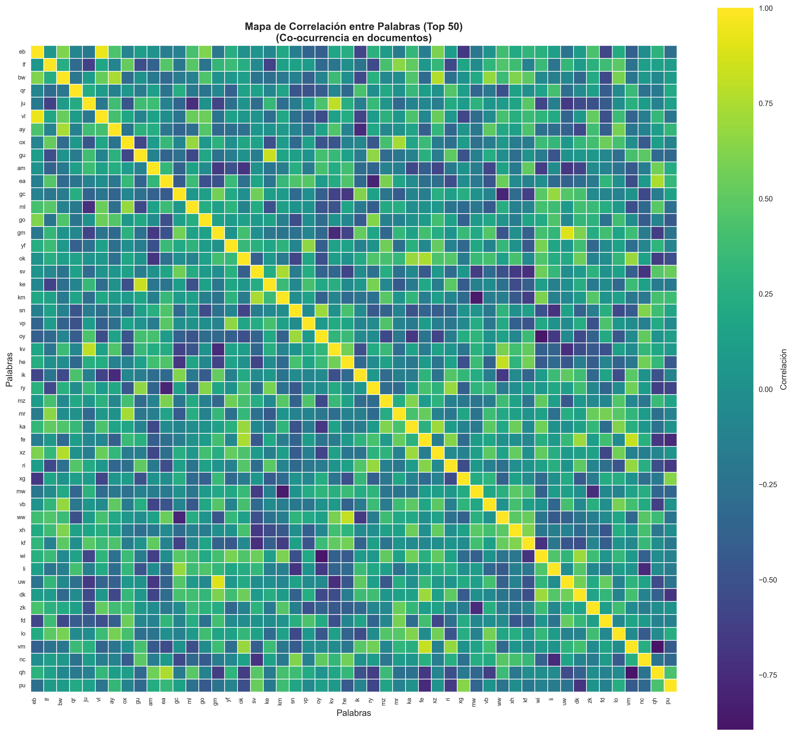
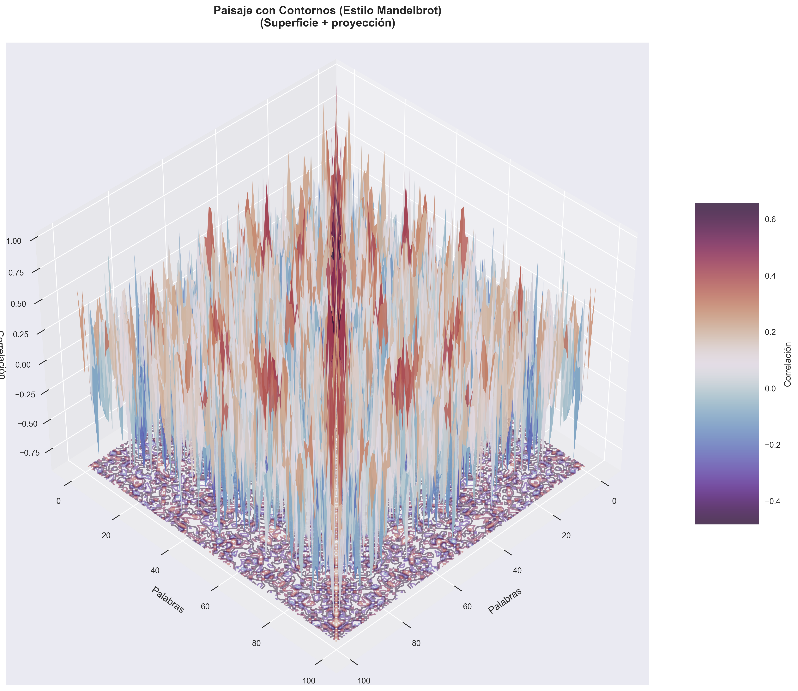
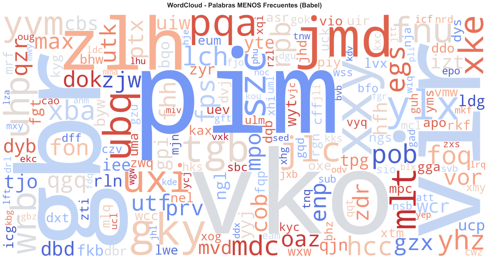
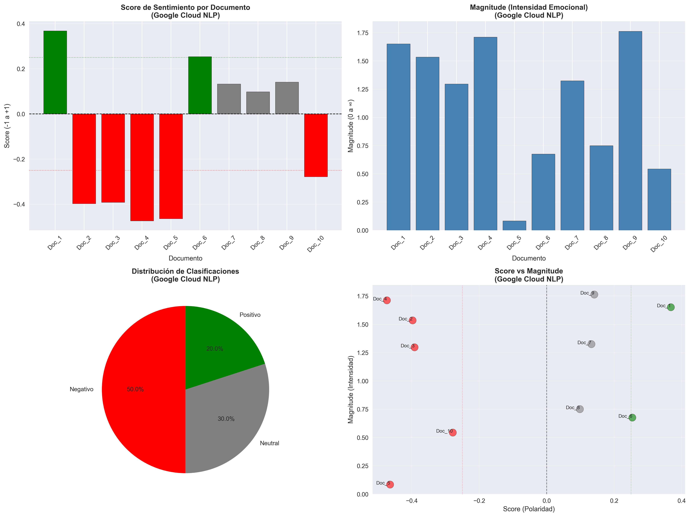

<div align="center">

# 📕 Phase 1 — The original study

**`MINERIA_BIBLIOTECA_BABEL_v1.ipynb`** · January 2026

*Preserved exactly as it ran. Nothing here has been corrected.*

</div>

---

## Why this folder exists

This is the study that started the project — a classic text mining pipeline over ten
random books from [libraryofbabel.info](https://libraryofbabel.info). It found things.
The things looked remarkable.

**Every measurement in this notebook was correctly computed.** The code does what it says.
What it lacked was any way to tell whether the results came from *the text* or from *the
instrument* — there was no null model and no control group.

[Phase 2](../Babel_V2/) adds both, and every finding below flips. **The v1 is kept intact
because the v2 is an argument about it**: delete this notebook and the reinterpretation
loses the object it refers to.

---

## What it found

| Finding | v1 reported | What phase 2 showed |
|:---|:---|:---|
| **Stopwords** | ~9% of tokens flagged as stopwords in random text | The number is **real** — and the null model reproduces it at 7.5%. Pure combinatorics over a 30-symbol alphabet |
| **Stemming** | "Successful" — 8.5% of tokens modified | Null model: 8.6%. A mechanical string edit, not morphology |
| **Lemmatization** | "Successful" — 1.6% lemmatized | Null model: 1.6%. Same |
| **Sentiment** | Positive polarity across all ten books | TextBlob reads noise (+0.225) as **more positive than Moby Dick** (+0.083) |
| **Correlation map** | The books share "statistical DNA" — **676 peaks at r > 0.5** | With n = 10 documents, chance alone predicts **699**. The headline number came in 3.2% *below* noise |
| **Rarest words** | "Always 3 characters" | Minimum length is 1. Does not hold |

---

## The pipeline it ran

```
1. Carga de datos            →  10 .txt files
2. Exploración inicial
3. Preprocesamiento y limpieza
4. Tokenización               →  NLTK word_tokenize
5. Stopwords multi-idioma     →  9 languages
6. Filtrado estructural
7. Stemming multi-idioma      →  Snowball
8. Lematización multi-idioma  →  spaCy
9. Análisis de frecuencias
10. WordCloud — palabras menos frecuentes
11. Vectorización             →  BoW + TF-IDF
12. Mapa de correlación entre palabras
13. Visualización 3D — paisaje de correlación
14. Análisis de sentimientos  →  TextBlob
15. Resumen final y exportación
```

Phase 2 preserves **every one of these steps**. That was an explicit requirement: the
reconstruction had to pass through the same ground and reinterpret it, not replace it
with something more sophisticated.

---

## Figures

The originals are in [`figures/`](figures/), untouched.

| | |
|:---:|:---:|
|  |  |
| **Correlation map between words** — the headline figure | **3D correlation landscape** — six views of the same surface |
|  |  |
| **Rare-word cloud** | **Sentiment analysis** |

`correlacion_palabras_top500_2.png` is not shown inline: it is **40,691 × 44,966 pixels**
(9.5 MB), a correlation map of 500 words rendered at full resolution. No browser renders
it usefully. It is kept as-is.

---

## ⚠️ This notebook does not run from here

Cell 2 contains a hardcoded absolute path:

```python
ruta_base = 'C:/Users/diego.perezp/Documents/DATA SCIENCE/Mineria de Texto/MUESTRA_BIBLIOTECA_BABEL/'
```

The corpus now lives in [`../data/`](../data/). The notebook is preserved as a **historical
record with its outputs embedded**, not as something to re-run — which is why the path was
left as it was rather than quietly patched.

That hardcoded path is itself one of the concrete problems phase 2 fixed: the v2 uses
`pathlib` with auto-detection and no hardcoded locations anywhere.

---

## What came out of it

The v1 is not a failure. It is the reason the project has a thesis.

> **The problem was never the measurements. It was that there was no way to know whether
> they came from the text or from the instrument.**

That sentence is the whole study, and it could not have been written without a study that
demonstrated the problem first.

---

<div align="center">

**→ [Phase 2: the reconstruction](../Babel_V2/)** · **[Back to the main README](../README.md)**

</div>
