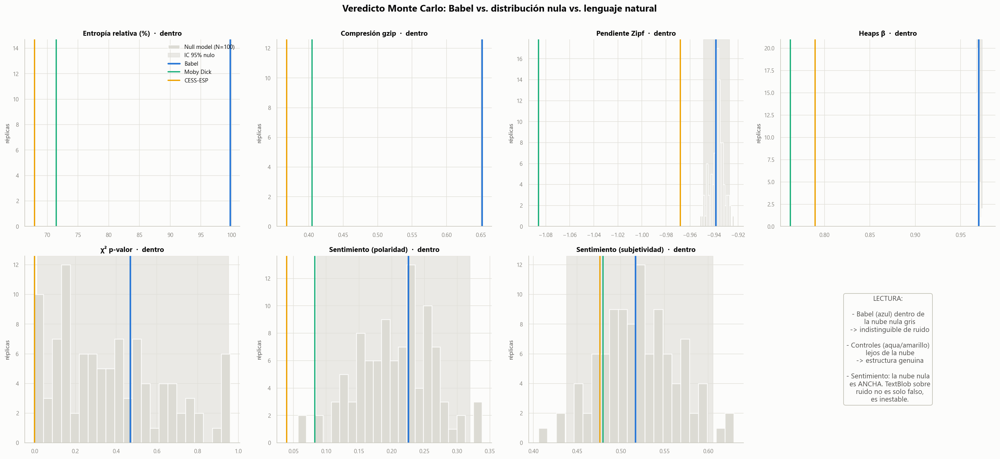
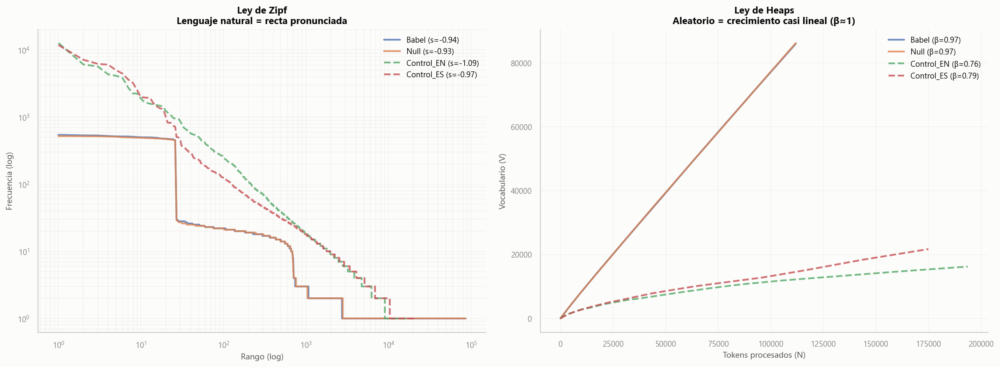
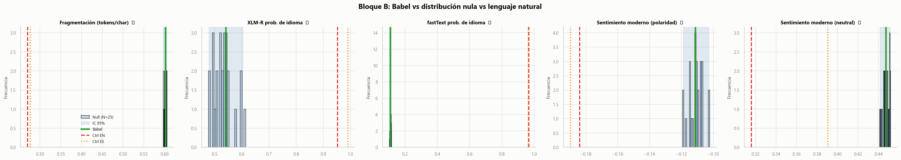
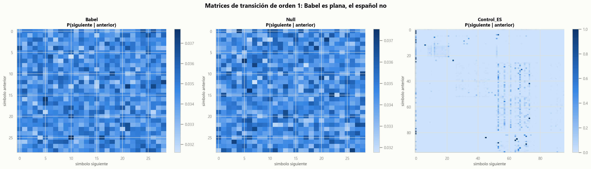
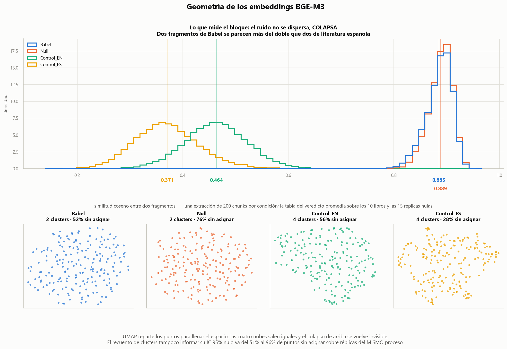
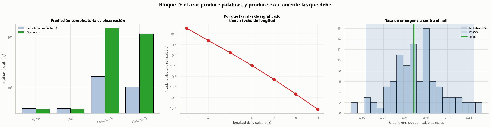
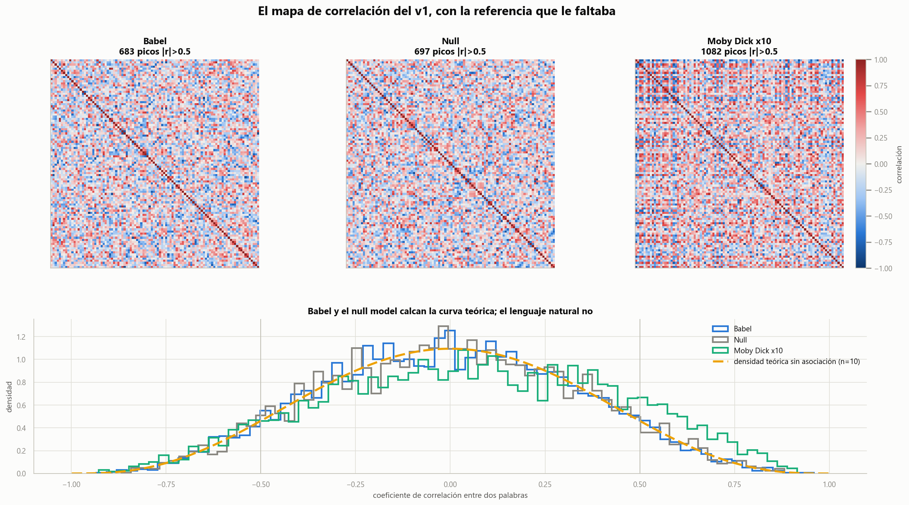

<div align="center">

# 📗 Fase 2 — Minando lo Aleatorio v2

**Reconstrucción rigurosa del estudio de text mining sobre la Biblioteca de Babel**

`Bloques A · B · C · D completados y validados sobre el corpus completo`

**24 métricas · 4 condiciones · 13.288.080 caracteres · 180 tests**

</div>

---

## 🎯 Qué resuelve este v2

[La fase 1](../Babel_V1/) reportaba "sesgos sorprendentes" en texto aleatorio —9% de
stopwords, lematización exitosa, sentimiento positivo, correlaciones entre libros— pero
**no tenía forma de distinguir señal de artefacto**. El v2 lo corrige con el método
científico estándar:

| Componente nuevo | Propósito |
|---|---|
| **Null model** | Texto sintético con la misma ley generadora → gemelo estadístico |
| **Controles ES/EN** | Moby Dick + CESS-ESP → referencia de lenguaje natural |
| **24 métricas formales** | Repartidas en cuatro bloques, de la entropía de Shannon a BGE-M3 |
| **Veredicto Monte Carlo** | Réplicas nulas → ubicar Babel en la distribución por percentil e IC 95% |

> ### ⭐ Principio rector
> **Cualquier "patrón" o "hallazgo" nuevo DEBE contrastarse contra el null model antes de
> considerarse real.** Se aplicó sin excepción, incluidas las cuatro veces que obligó a
> rediseñar.

**Resultado: Babel es indistinguible del null model en las 24 métricas.**

---

## 📊 El veredicto, bloque a bloque



### Bloque A — fundamentos: 7 de 7 indistinguibles

| Métrica | Babel | Null μ | IC 95% nulo | Percentil | |
|---|---:|---:|:---:|:---:|:---:|
| Entropía relativa (%) | 99,7454 | 99,7454 | [99,745, 99,746] | 53 | ✓ |
| Compresión gzip | 0,6512 | 0,6513 | [0,651, 0,651] | 49 | ✓ |
| Pendiente Zipf | −0,9386 | −0,9372 | [−0,949, −0,927] | 34 | ✓ |
| Heaps β | 0,9697 | 0,9695 | [0,968, 0,974] | 70 | ✓ |
| χ² p-valor | 0,4687 | 0,3784 | [0,015, 0,952] | 65 | ✓ |
| Sentimiento (polaridad) | 0,2254 | 0,2051 | [0,085, 0,320] | 60 | ✓ |
| Sentimiento (subjetividad) | 0,5167 | 0,5214 | [0,438, 0,605] | 46 | ✓ |

Y el lenguaje natural sí se separa:

| | Babel | Null | Moby Dick | CESS-ESP |
|---|---:|---:|---:|---:|
| Entropía relativa | 99,7% | 99,7% | 71,4% | 67,9% |
| Compresión gzip | 0,651 | 0,651 | 0,405 | 0,368 |
| Heaps β | 0,971 | 0,969 | 0,762 | 0,790 |
| **Tipos únicos / tokens** | **0,769** | **0,771** | **0,084** | **0,124** |
| % stemming modificado | 8,5% | 8,6% | 32,2% | 80,3% |
| % lematizado | 1,6% | 1,6% | 7,9% | 35,6% |



### Bloque B — NLP moderno: 5 de 5 indistinguibles



| Métrica | Babel | Null μ | Pctil | Moby Dick | CESS-ESP |
|---|---:|---:|:---:|---:|---:|
| Fragmentación (tokens/char) | 0,603 | 0,602 | 60 | 0,270 | 0,276 |
| XLM-R prob. de idioma | 0,542 | 0,532 | 68 | 0,953 | 0,991 |
| **fastText prob. de idioma** | **0,110** | 0,110 | 43 | **0,967** | **0,963** |
| Sentimiento moderno (polaridad) | −0,111 | −0,111 | 40 | −0,184 | −0,190 |
| Sentimiento moderno (neutral) | 0,447 | 0,447 | 48 | 0,316 | 0,391 |

**Los dos detectores fallan de forma opuesta.** fastText reparte la probabilidad y se
queda en 0,11: reconoce que no sabe. XLM-R concentra 0,54 en **hindi**, en el 100% de las
ventanas, con la misma consistencia con la que etiqueta el español real. Un transformer
de 278M de parámetros está seguro y equivocado; un clasificador lineal sobre n-gramas de
caracteres es honesto. **La capacidad del modelo no predice su calibración.**

### Bloque C — estructura secuencial: 3 de 3 indistinguibles



| Métrica | Babel | Null μ | IC 95% nulo | Pctil | Ctrl_EN | Ctrl_ES |
|---|---:|---:|:---:|:---:|---:|---:|
| Ganancia de información (k=1) | 0,0005 | 0,0005 | [0,0005, 0,0006] | 71 | 0,909 | 1,085 |
| Ganancia de información (k=2) | 0,0155 | 0,0156 | [0,0154, 0,0159] | 29 | 1,620 | 1,683 |
| Ganancia de información (k=3) | 0,5255 | 0,5255 | [0,5243, 0,5269] | 53 | 2,226 | 2,266 |

**Perplejidad** — modelo de caracteres de orden 5 entrenado sobre el 80% de CESS-ESP:

| Texto evaluado | bits/char | Perplejidad | vs uniforme (29) |
|---|---:|---:|---:|
| Español retenido | 2,261 | 4,8 | 0,17× |
| Inglés (Moby Dick) | 5,990 | 63,6 | 2,19× |
| **Babel** | **7,912** | **240,9** | **8,31×** |
| Null model | 7,906 | 239,8 | 8,27× |

Divergencia Jensen-Shannon entre matrices de transición: **Babel vs Null = 0,0003**;
Babel vs español = 0,5424.

### Bloque C — geometría de embeddings: 5 de 5 indistinguibles



> **Arriba** va la métrica de verdad: la distribución de similitudes por pares. Babel y el
> null son la misma espiga estrecha en 0,888; el inglés y el español real son anchos y muy
> por debajo. **Abajo**, los mismos datos pasados por UMAP, que normaliza la densidad local
> por construcción: las cuatro nubes salen iguales y el colapso se vuelve invisible. La
> proyección se conserva justamente para exhibir eso.

Sobre **BGE-M3** (BAAI, 2024; 568M parámetros, 1024 dimensiones), chunks de 200 caracteres:

| Métrica | Babel | Null μ | IC 95% nulo | Pctil | Ctrl_EN | Ctrl_ES |
|---|---:|---:|:---:|:---:|---:|---:|
| Similitud media entre chunks | 0,8878 | 0,8874 | [0,884, 0,891] | 53,3 | 0,464 | 0,371 |
| Dispersión de similitudes | 0,0239 | 0,0241 | [0,022, 0,028] | 60,0 | 0,060 | 0,062 |
| Dimensión efectiva | 86,90 | 86,78 | [83,86, 89,15] | 46,7 | 82,66 | 88,20 |
| Clusters HDBSCAN | 2,5 | 2,27 | [0,70, 3,65] | 66,7 | 4,0 | 4,0 |
| % puntos sin cluster | 69,25 | 71,63 | [51,25, 95,98] | 33,3 | 56,5 | 28,0 |

> **La ausencia de estructura se manifiesta como uniformidad, no como dispersión.** Los
> fragmentos de Babel se parecen entre sí **más del doble** que los de la literatura
> española (0,888 contra 0,371). Para el modelo, dos trozos de ruido son casi el mismo
> objeto: intercambiables, porque no hay nada que los distinga. Babel no "deja de
> agruparse" — **colapsa en una bola.**
>
> Invierte la intuición de partida. Conviene tenerlo escrito antes de mirar cualquier
> resultado de clustering sobre texto degenerado.

**Dos negativos documentados, reportados en vez de enterrados:**

- **BERTopic halla más tópicos en el ruido que en el español** (3 contra 2). La herramienta
  no falla en silencio, falla **con aplomo**. Lo que sí ordena bien las condiciones es el
  % de outliers: 20 → 45 → 64,5 → 85.
- **El recuento de clusters de HDBSCAN es casi inservible.** El IC 95% nulo del porcentaje
  de puntos sin cluster va del **51,3% al 96,0%** sobre 15 réplicas del *mismo* proceso.

**MinHash** sobre shingles de 8 caracteres, 128 permutaciones: **Jaccard = 0,000000 en los
21 pares.** Ni una sola secuencia de ocho caracteres compartida. El "ADN estadístico"
liquidado.

### Bloque D — significado emergente: 4 de 4 indistinguibles



| Métrica | Babel | Null μ | IC 95% nulo | Pctil |
|---|---:|---:|:---:|:---:|
| Tasa de palabras reales (%) | 4,2714 | 4,2787 | [4,159, 4,412] | 49 |
| Palabras emergentes | 3.758,7 | 3.768,2 | [3.655,8, 3.888,1] | 43 |
| Palabras distintas | 2.907,9 | 2.918,1 | [2.838,3, 2.990,6] | 41 |
| Longitud máxima | 5,5 | 5,56 | [5,00, 6,00] | 46 |

#### El resultado más fuerte del estudio: la predicción en cerrado

Si Babel es ruido i.i.d. sobre 26 letras, cuántas palabras reales deben emerger no hay que
medirlo: **se calcula antes de mirar el texto.**

<div align="center">

### `P(k) = N_k / 26ᵏ`

</div>

| Condición | Predichas | Observadas | **Obs / Pred** |
|---|---:|---:|:---:|
| **Babel** | 3.860,9 | 3.766 | **0,98** |
| **Null** | 3.864,0 | 3.798 | **0,98** |
| Control_EN | 16.725,3 | 150.914 | **9,02** |
| Control_ES | 10.449,1 | 117.267 | **11,22** |

Sin ajustar un solo parámetro, sin null model, sin ninguna herramienta de NLP. La longitud
media de token, predicha como geométrica de parámetro 3/29 en **8,67**, se midió en **8,75**.

> **Esto cambia la categoría de la conclusión.** En A, B y C se demuestra que la emergencia
> de estructura es *indistinguible* del azar. Aquí se demuestra que **es azar y se conoce
> la fórmula generadora.** Y la razón Obs/Pred se convierte en una medida directa de
> intención: el lenguaje natural produce entre 9 y 11 veces más palabras válidas de las que
> el azar explicaría.

**Por qué las islas de significado tienen techo:** con 3 letras, el 36% de todas las
cadenas posibles son palabras reales; con 9, ocho entre mil millones. El diccionario crece,
pero el espacio de cadenas crece por 26 en cada paso. **La palabra más larga de Babel tiene
5 letras; el español llega a 19.**

---

## 🧪 Los siete artefactos del instrumento

La sección con más valor metodológico. Siete "hallazgos" de corridas intermedias
resultaron ser **defectos del aparato de medición**, no propiedades de Babel.

| # | Artefacto | Síntoma | Causa real |
|:---:|---|---|---|
| 1 | **Zipf** | Percentil 99 | El ajuste incluía la cola de hapax: casi todo el vocabulario en texto aleatorio, y una recta horizontal en log-log |
| 2 | **χ²** | Percentil 100 | El null se calibraba con una muestra de 9.475 caracteres: heredaba su ruido y le sumaba ruido fresco |
| 3 | **Entropía** | Percentil 100 | El null no replicaba la paginación: `\n` a 1/81 en vez de 1/79,06 |
| 4 | **Sentimiento** | Babel al doble que el null | La limpieza borraba comas y puntos en vez de tratarlos como frontera |
| 5 | **Conteo de tokens** | Dos vocabularios, un corpus | `babel_core` y `babel_pipeline` tokenizaban distinto: 111.797 vs 48.961 tokens del mismo texto |
| 6 | **Entropía de orden 4** | **Invertía la conclusión** | Ver abajo |
| 7 | **n = 10** | 676 "picos" en el v1 | Tamaño de muestra, no estructura |

### El sexto, y el que habría invertido una conclusión

| Condición | k=1 | k=2 | k=3 | **k=4** | obs/contexto |
|---|---:|---:|---:|---:|---:|
| Babel | 0,0005 | 0,0155 | 0,5258 | **3,7446** | 2,0 |
| Null | 0,0005 | 0,0157 | 0,5254 | **3,7442** | 2,0 |
| Control_EN | 0,9087 | 1,6198 | 2,2263 | 2,6823 | 17,9 |
| Control_ES | 1,0852 | 1,6835 | 2,2663 | 2,7475 | 21,2 |

**A orden 4 el estimador plug-in atribuye a Babel un 36% MÁS de estructura secuencial que
al español.** La causa no es el texto: es escasez de datos. A orden 4 el ruido genera más
de medio millón de contextos distintos con **2,0 observaciones cada uno**, cada distribución
condicional empírica parece determinista y la entropía condicional se desploma.

> El null model da 3,7442 frente a 3,7446. Un valor absurdo que el gemelo estadístico
> reproduce con esa precisión no es un hallazgo: es una propiedad del estimador.
>
> **Sin el null model, este bloque habría publicado que el ruido tiene más memoria que la
> literatura.**

El veredicto se limita a k ∈ {1, 2, 3}. El k=4 se calcula y se publica igualmente, como
exhibición del límite.

### El séptimo: n = 10



El v1 correlacionaba **palabras entre sí** a lo largo de los 10 documentos y reportaba
*"Picos detectados (correlación > 0.5): 676"*. Con n=10, bajo no-asociación,
`P(|r| > 0,5) = 0,1411`; sobre las C(100,2) = 4.950 parejas salen **699 pares por puro
azar**. El hallazgo estrella del v1 está un **3,2% por debajo** de lo que predice el ruido.

| | picos \|r\|>0,5 | % de pares | esperado por azar |
|---|---:|---:|---:|
| Babel | 683 | 13,8% | 14,1% |
| Null | 697 | 14,1% | 14,1% |
| **Moby Dick partido en 10** | **1.082** | **21,9%** | 14,1% |

**La métrica no está rota**: el lenguaje natural la supera con holgura. El problema eran
los 10 documentos. Con n=50 la tasa de falsos picos cae al 0,02%.

---

## 📁 Estructura

```
Babel_V2/
├── MINERIA_BIBLIOTECA_BABEL_v2.ipynb   # Notebook principal (76 celdas, ejecutado)
├── requirements.txt · pytest.ini · README.md
│
├── src/                                # MOTOR: funciones puras, testeables, sin visualización
│   ├── babel_core.py                   # Null model, controles, métricas de aleatoriedad
│   ├── babel_pipeline.py               # Pipeline clásico de minería de texto
│   ├── babel_transformers.py           # Bloque B — ventanas, transformers, fastText
│   ├── babel_secuencia.py              # Bloque C — Markov, entropía condicional, perplejidad
│   ├── babel_embeddings.py             # Bloque C — BGE-M3, geometría, UMAP, BERTopic, MinHash
│   ├── babel_lexico.py                 # Bloque D — léxico externo, predicción combinatoria
│   └── babel_viz.py                    # Paleta, estilo, figuras del v1 revisitadas
│
├── tests/                              # 180 tests (~15 s)
│   ├── conftest.py                     # Fixtures; localiza src/ y los datos
│   ├── test_parseo.py (13)             ├── test_secuencia.py (23)
│   ├── test_null_model.py (13)         ├── test_embeddings.py (19)
│   ├── test_metricas.py (24)           ├── test_lexico.py (24)
│   ├── test_pipeline.py (22)           └── test_regresiones.py (9)
│   └── test_transformers.py (30)
│
├── outputs/                            # 27 tablas CSV
└── figures/                            # 14 figuras PNG
```

**Separación estricta lógica / presentación.** Todo `src/` es lógica pura: sin
visualización, sin narrativa. El notebook importa, orquesta, muestra y narra. El v1
mezclaba ambas en celdas de cientos de líneas — que es exactamente por lo que era
imposible de mantener y testear.

Los 10 libros viven en [`../data/`](../data/). El notebook los **auto-detecta**: busca en
`data/` del proyecto → `data/` de la raíz del repo → carpeta padre → el propio proyecto;
gana la primera ubicación con archivos `.txt`.

---

## 🚀 Cómo correr

```bash
pip install -r requirements.txt
```

```bash
python -m spacy download es_core_news_sm && python -m spacy download en_core_web_sm
```

```bash
python -m textblob.download_corpora
```

```bash
python -c "import nltk; nltk.download('gutenberg'); nltk.download('cess_esp'); nltk.download('stopwords'); nltk.download('wordnet')"
```

Abre el notebook en Jupyter (probado en Notebook 7.x) y ejecuta todo.

| Bloque | Tiempo (CPU, 12 núcleos) | Descarga |
|---|---|---|
| A — Fundamentos | ~3 min | — |
| B — NLP moderno | ~12 min | ~3,2 GB de modelos |
| C — Secuencial + embeddings | ~42 min | ~4,3 GB más (BGE-M3) |
| D — Léxico | ~4 min | solo diccionarios |
| Figuras del v1 revisitadas | ~4 min | — |
| **Run All completo** | **~1 hora** | **7,7 GB la primera vez** |

Cada bloque tiene bandera para saltárselo (`EJECUTAR_BLOQUE_B`, `EJECUTAR_BLOQUE_C2`) y
`MODO_RAPIDO_CHARS = 200_000` hace un smoke test en un minuto.

> **Si editas algo en `src/`:** la celda de imports recarga los módulos con
> `importlib.reload` y verifica que el kernel tenga la API esperada. Sin eso, Python sirve
> la versión cacheada y las funciones nuevas fallan con `AttributeError` varias celdas más
> abajo, con un mensaje que no apunta a la causa. Esto costó una corrida completa.

---

## 🧪 Tests

```bash
python -m pytest
```

**180 tests, ~15 segundos.** Correrlos antes y después de tocar `src/`.

Lo distintivo no es la cobertura sino **qué se testea**: además de las funciones, se fijan
los **invariantes científicos** del estudio. Que Zipf *no* separe Babel del español y que
Heaps *sí* lo haga son tests. Si empiezan a fallar, la alarma suena antes de llegar a las
conclusiones.

La suite **no necesita el corpus ni los 7,7 GB de modelos**: si faltan los `.txt` o alguna
dependencia opcional, esos tests se saltan en vez de fallar. Los de `test_transformers.py`
y `test_embeddings.py` usan modelos simulados.

---

## 🔬 Decisiones metodológicas

Las 23 están registradas con su justificación en
[`../Documents/CONTEXT.md`](../Documents/CONTEXT.md) §5 y
[`../Documents/STACK_Y_METODOLOGIA.md`](../Documents/STACK_Y_METODOLOGIA.md) §4. Las que
más cambiaron resultados:

- **Parseo de metadata.** Los `.txt` traen línea de título y footer `Book Location:...` con
  mayúsculas, dígitos y `:`. Sin retirarlos el alfabeto pasa de 30 a 44 símbolos.
- **Formato del null model medido, no asumido.** 410 páginas × 40 líneas × 80 caracteres.
  Sin replicar la línea en blanco entre páginas, `\n` queda en 1/81 en vez de 1/79,06 y la
  entropía separa Babel del null **por motivos tipográficos**.
- **Tokenización: los no alfabéticos son frontera de palabra**, no se borran. Borrarlos
  pega tokens vecinos, y el sesgo es asimétrico: largo medio de token en Babel 20,0 en vez
  de 8,7, sin mover a los controles.
- **Umbral de longitud `>=3`** con tabla de sensibilidad, separando explícitamente "tokens
  cortos" de "stopwords reales".
- **Ajuste de Zipf sin la cola de hapax**; **Heaps con tabla de sensibilidad al tramo**;
  **χ² con el espacio completo de categorías `A^n`**.
- **Perplejidad con n-gramas de caracteres, no de palabras.** A nivel de palabra el modelo
  asigna probabilidad ≈0 a cada token de Babel y la perplejidad sale infinita.
- **BGE-M3 en lugar del MiniLM previsto.** La conclusión del bloque es negativa; un negativo
  con modelo débil no cierra la objeción "quizá con un modelo mejor sí aparecería".
- **Léxico externo** (`wordfreq` + `pyspellchecker`), no el vocabulario de los controles:
  rompe la circularidad del diccionario de referencia.
- **TextBlob conservado a propósito** como demostración de artefacto, no como medición.

---

## 📖 Documentación

| Documento | Qué contiene |
|---|---|
| [`../README.md`](../README.md) | Presentación del proyecto completo, las dos fases |
| [`../Babel_V1/`](../Babel_V1/) | La fase 1: el estudio original, preservado |
| [`../Documents/CONTEXT.md`](../Documents/CONTEXT.md) | Handoff operativo: contexto científico, decisiones que no revertir, roadmap |
| [`../Documents/STACK_Y_METODOLOGIA.md`](../Documents/STACK_Y_METODOLOGIA.md) | Referencia técnica: inventario razonado del stack, estado del arte, metodología |

---

<div align="center">

**Diego Evans Pérez Paz** · *Complejidad y Caos* — Enero 2026

</div>
