<div align="center">

# 📚 Mining the Random
### Text Mining on Borges' Library of Babel

*Does true randomness leave traces? Can chaos generate patterns —*
*or is every "pattern" we detect an artifact of our own tools?*

<br>

**`24 metrics`** · **`4 conditions`** · **`13.3M characters`** · **`180 tests`**
**`0 findings survived`**

<br>

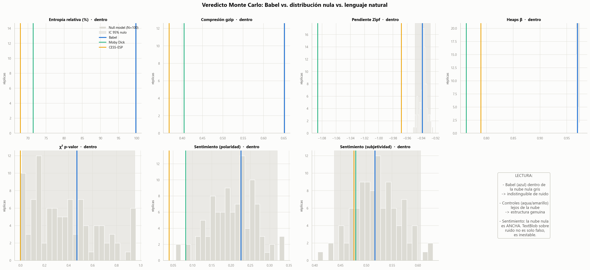

<sub>**The whole study in one figure.** The grey histogram is the null model's distribution.
Babel (blue) falls inside it every time. The controls — real English and Spanish —
sit far outside. Seven metrics, and the random text is never distinguishable from
synthetic noise.</sub>

</div>

---

> *"The Library of Babel contains all possible books... somewhere in it lies every
> truth, every coherent thought — and also pure chaos."*
> — **Jorge Luis Borges**, *La Biblioteca de Babel* (1941)

---

## 🎯 The verdict

Ten books were pulled at random from [libraryofbabel.info](https://libraryofbabel.info),
a digital implementation of Borges' infinite library where every book is a random
combination of a reduced alphabet. Then twenty-four metrics were run against them —
from a 2001 stemmer to a 568M-parameter neural encoder — each one contrasted against
a **null model**: synthetic text following the exact same generative law.

<div align="center">

| Block | Question | Metrics | Result |
|:---|:---|:---:|:---:|
| **A** — Foundations | Do classical metrics tell Babel from noise? | 7 | 🟰 **0 / 7** |
| **B** — Modern NLP | Do transformers? | 5 | 🟰 **0 / 5** |
| **C** — Structure & geometry | Is there sequential memory? Are there clusters? | 8 | 🟰 **0 / 8** |
| **D** — Emergent meaning | How much meaning arises by pure chance? | 4 | 🟰 **0 / 4** |
| | | **24** | **0 distinguishable** |

</div>

Not one metric separates Babel from its statistical twin. Every one of them separates
real language cleanly. **The tools work — there is simply nothing there to find.**

---

## 🔀 This repository has two phases

The project exists twice, and keeping both is the point.

<table>
<tr>
<td width="50%" valign="top">

### 📕 [`Babel_V1/`](Babel_V1/) — the original study

A classic NLP pipeline. It reported findings that looked remarkable:

- ~9% of tokens flagged as **stopwords**
- **Lemmatization and stemming** "successful"
- **Positive sentiment** across all ten books
- A correlation map showing the books shared **"statistical DNA"** — *676 peaks above r > 0.5*

Every measurement was correctly computed.

</td>
<td width="50%" valign="top">

### 📗 [`Babel_V2/`](Babel_V2/) — the reconstruction

The same pipeline, plus the two things v1 lacked: a **null model** and **control corpora**.

- The 9% is real — **and the null model reproduces it exactly**
- Stemming and lemmatization: **mechanical string edits**
- TextBlob reads noise as *more positive than literature*
- Those 676 peaks? Pure chance predicts **699**

Nothing was deleted. Everything was reinterpreted.

</td>
</tr>
</table>

> **The problem was never the measurements. It was that the study had no way to tell
> whether they came from the text or from the instrument.**

### The single clearest illustration

The same computation, run twice — once without a reference, once with one.

<table>
<tr>
<td width="34%" valign="top" align="center">

**v1** — correlation between words

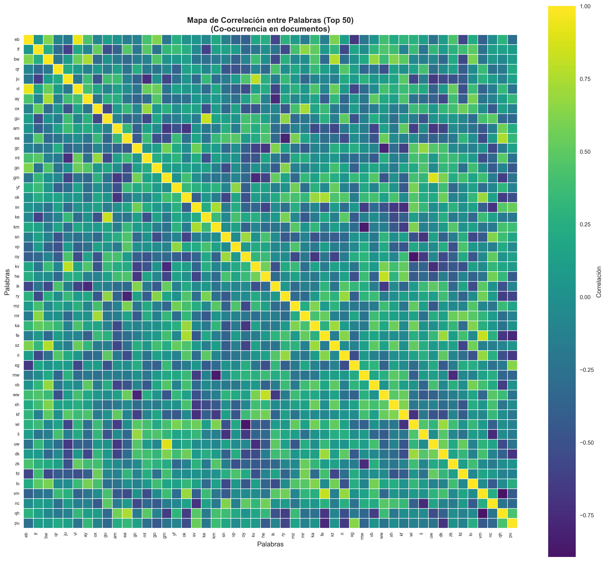

<sub>A structure appears. There is nothing to compare it against.</sub>

</td>
<td width="66%" valign="top" align="center">

**v2** — the same map, with the reference it was missing

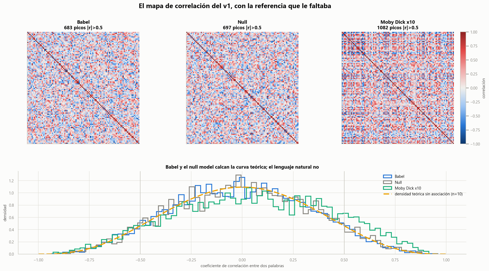

<sub>Babel: 683 peaks. Null model: 697. Theoretical chance: 699.
Moby Dick, split into ten documents: **1,082**.</sub>

</td>
</tr>
</table>

**The metric was never broken** — natural language clears the chance threshold with room
to spare. The problem was **n = 10**. With ten documents, `P(|r| > 0.5) = 0.1411` under
no association at all; across 4,950 word pairs that is 699 peaks from nothing. v1's
headline finding came in **3.2% below what pure noise predicts.**

With n = 50, the false-peak rate drops to 0.02%.

---

## 🗂️ The dataset

<div align="center">

| Parameter | Value |
|:---|:---|
| Books analyzed | **10**, drawn at random |
| Alphabet | **30 symbols** — `a-z` + space + comma + period + newline |
| Physical format | **410 pages × 40 lines × 80 characters** |
| Body per book | 1,328,808 characters — *identical across all ten* |
| Total corpus | **13,288,080 characters** |
| Comparison size | 1,104,297 chars per condition (set by the shortest control) |

</div>

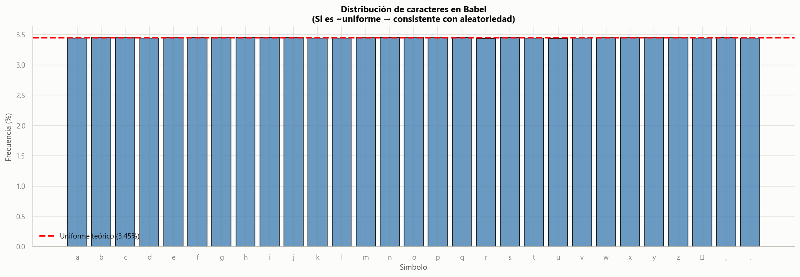

The 410 pages are not incidental — that is the number Borges specifies in the story,
and the site implements it literally. Pages are separated by a blank line, which puts
the real newline frequency at **1/79.06** rather than 1/81. Reproducing that one detail
turned out to decide an entire verdict.

---

## 🔬 The method

Four conditions, one identical pipeline:

<div align="center">

| Condition | What it is |
|:---|:---|
| 🔵 **Babel** | The real random text under study |
| ⚪ **Null model** | Synthetic text following the *same generative law* — calibrated alphabet, same page layout |
| 🟢 **Control EN** | *Moby Dick* (Melville, 1851), public domain |
| 🟡 **Control ES** | CESS-ESP corpus, Spanish academic standard |

</div>

Every metric is contrasted against a **Monte Carlo distribution of null replicas**, and
Babel is located inside it by percentile and 95% confidence interval.

> ### ⭐ Guiding principle
> **Any "finding" must be contrasted against the null model before it counts as real.**
> It was applied without exception — including the four times it forced a redesign.

---

## 📊 Results

### Block A — classical metrics: 0 / 7

<details>
<summary><b>Full verdict table</b></summary>

<br>

| Metric | Babel | Null μ | 95% CI | Percentile |
|:---|---:|---:|:---:|:---:|
| Relative entropy (%) | 99.7454 | 99.7454 | [99.745, 99.746] | 53 |
| gzip compression | 0.6512 | 0.6513 | [0.651, 0.651] | 49 |
| Zipf slope | −0.9386 | −0.9372 | [−0.949, −0.927] | 34 |
| Heaps β | 0.9697 | 0.9695 | [0.968, 0.974] | 70 |
| χ² p-value | 0.4687 | 0.3784 | [0.015, 0.952] | 65 |
| Sentiment (polarity) | 0.2254 | 0.2051 | [0.085, 0.320] | 60 |
| Sentiment (subjectivity) | 0.5167 | 0.5214 | [0.438, 0.605] | 46 |

Not one falls outside the null interval.

</details>

Natural language, by contrast, separates on every single one:

| | Babel | Null | Moby Dick | CESS-ESP |
|:---|---:|---:|---:|---:|
| Relative entropy | 99.7% | 99.7% | 71.4% | 67.9% |
| gzip / bz2 | 0.651 / 0.622 | 0.651 / 0.622 | 0.405 / 0.308 | 0.368 / 0.279 |
| Heaps β | 0.971 | 0.969 | 0.762 | 0.790 |
| **Unique types / tokens** | **0.769** | **0.771** | **0.084** | **0.124** |

The bluntest separator needs no curve fitting at all: **77% of Babel's tokens are unique
types, against 8.4% of Moby Dick's.**

#### Zipf's law does *not* discriminate — and that is the lesson

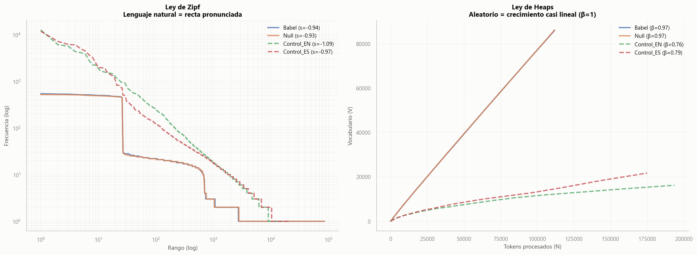

Babel's Zipf slope is **−0.940** (R²=0.858). Real Spanish comes in at **−0.968** (R²=0.988).

Random text obeys Zipf's law. This is the classic "monkey at the typewriter" result of
Miller (1957) and Mandelbrot (1953), reproduced on a concrete corpus. **Heaps' law does
separate** — and its behaviour under fit range separates even better: Babel's β stays flat
at ~0.97 wherever you start the fit, while natural language's β falls as you exclude the
early curve (English: 0.762 → 0.549). That decline is the signature of genuine vocabulary
saturation.

#### The stopwords myth

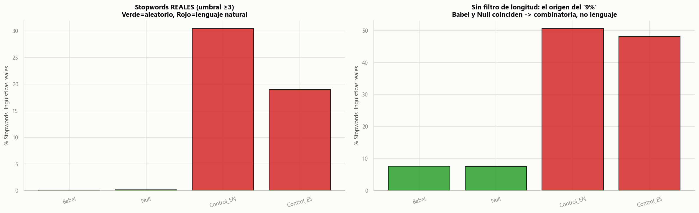

<details>
<summary><b>The v1 findings, one by one</b></summary>

<br>

| Original claim | Babel | Null model | Verdict |
|:---|:---|:---|:---|
| "~9% stopwords" | 7.6% unfiltered · 0.115% at ≥3 letters | 7.5% · 0.130% | Number is **real** — the null reproduces it. Pure combinatorics |
| "Successful stemming" | 8.48% modified | 8.56% | Mechanical string transformation |
| "Successful lemmatization" | 1.55% | 1.61% | Same |
| "Rarest words always 3 chars" | minimum 1 | minimum 1 | Does not hold |
| "Positive sentiment" | +0.225 | +0.205 | Identical to noise |
| "Books share statistical DNA" | — | — | They share it with the null model just as much |

For reference, the controls: stemming modifies 32.2% (EN) and 80.3% (ES); lemmatization
7.9% and 35.6%. There *is* morphology to find there.

</details>

#### Sentiment analysis deserves its own paragraph

TextBlob reads Babel at **+0.225** and the null model at **+0.205** — the same. But the
controls come in at **0.083** (Moby Dick) and **0.039** (CESS-ESP), essentially neutral.

> **TextBlob reads more positive sentiment in random text than in literature.**
> The tool was kept in the study deliberately — not as a valid measurement, but as a
> demonstration that it hallucinates *more* the less real text it has in front of it.

---

### Block B — modern NLP: 0 / 5

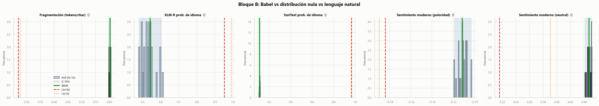

| Metric | Babel | Null μ | Pctile | Moby Dick | CESS-ESP |
|:---|---:|---:|:---:|---:|---:|
| Subword fragmentation (tokens/char) | 0.603 | 0.602 | 60 | 0.270 | 0.276 |
| XLM-R language probability | 0.542 | 0.532 | 68 | 0.953 | 0.991 |
| **fastText language probability** | **0.110** | 0.110 | 43 | **0.967** | **0.963** |
| Modern sentiment (polarity) | −0.111 | −0.111 | 40 | −0.184 | −0.190 |
| Modern sentiment (neutral mass) | 0.447 | 0.447 | 48 | 0.316 | 0.391 |

#### The two language detectors fail in opposite ways

| | Babel | Moby Dick | CESS-ESP |
|:---|:---:|:---:|:---:|
| fastText — probability | **0.110** | 0.967 | 0.963 |
| XLM-R — probability | **0.542** | 0.953 | 0.991 |
| XLM-R — label | 🇮🇳 **Hindi** | English | Spanish |

fastText spreads its probability and settles at 0.11 — **it admits it does not know**.
XLM-R concentrates 0.54 on *Hindi*, in **100% of windows**, with the same consistency it
shows labelling real Spanish as Spanish.

> A 278-million-parameter transformer is confidently wrong; a linear classifier over
> character n-grams is honest. **Model capacity does not predict calibration.**
>
> Note the trap: that 100% agreement across windows, *without the null model beside it*,
> would be trivially sold as "the model detects consistent structure". Language entropy
> is **zero** — exactly as it is for real Spanish. Only the null model reveals it as
> classifier bias.

---

### Block C — structure and geometry: 0 / 8

#### There is no sequential memory

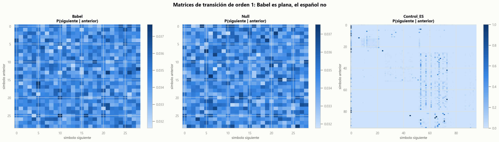

Knowing the previous three characters removes **0.53 bits** of uncertainty in Babel and
**2.23** in English. Jensen-Shannon divergence between Babel and the null model:
**0.0003**. Against Spanish: **0.5424**.

A character-level model trained on Spanish, asked to predict each condition:

| Text evaluated | bits/char | Perplexity | vs uniform (29) |
|:---|---:|---:|---:|
| Held-out Spanish | 2.261 | 4.8 | 0.17× |
| English (Moby Dick) | 5.990 | 63.6 | 2.19× |
| **Babel** | **7.912** | **240.9** | **8.31×** |
| Null model | 7.906 | 239.8 | 8.27× |

English gives the scale: a Spanish model predicts it badly — but **four times better than
it predicts Babel**, because it shares an alphabet and bigram statistics. Babel lands at
8.31× worse than knowing nothing at all. The model is *confidently wrong*, not ignorant.

#### Noise does not scatter — it collapses

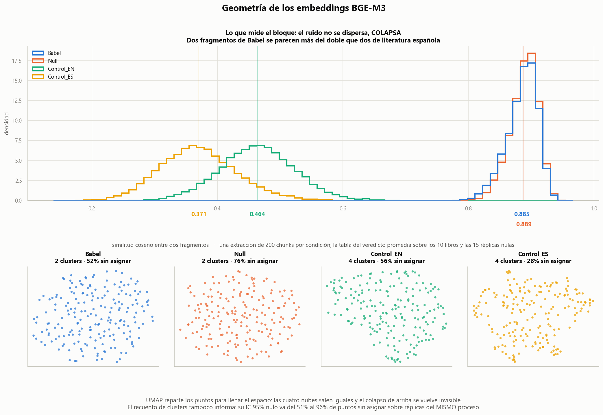

<sub>**Top:** the actual measurement — the distribution of pairwise cosine similarity.
Babel and the null model are the same narrow spike at 0.888; real English and Spanish are
broad and far lower. **Bottom:** the same data through UMAP, which normalizes local density
by construction — so all four clouds look identical and the collapse becomes invisible.
The projection is kept precisely to show that.</sub>

Run through **BGE-M3** (568M parameters, 1024 dimensions — the strongest open multilingual
encoder available):

| | Babel | Null | Moby Dick | CESS-ESP |
|:---|---:|---:|---:|---:|
| Mean similarity between chunks | **0.888** | 0.887 | 0.464 | **0.371** |
| Similarity to nearest neighbour | 0.922 | 0.923 | 0.617 | 0.566 |

> **Fragments of Babel resemble each other more than twice as much as fragments of
> Spanish literature do.** To the model, two pieces of noise are almost the same object —
> interchangeable, because nothing distinguishes them. Babel does not "fail to cluster."
> **It collapses into a ball.**
>
> This inverts the starting intuition, and it is worth holding on to before reading any
> clustering result on degenerate text.

And two documented negatives, reported rather than buried:

- **BERTopic finds *more* topics in noise than in Spanish** — 3 against 2. The tool does
  not fail silently; it fails *with poise*.
- **HDBSCAN's cluster count is nearly useless here.** Its null 95% CI for unassigned
  points runs from **51.3% to 96.0%** across replicas of the *same* process.

**MinHash, 8-character shingles, 128 permutations: Jaccard = 0.000000 across all 21 pairs.**
Not one eight-character sequence is shared between any two books. The "statistical DNA"
is gone.

---

### Block D — emergent meaning: 0 / 4

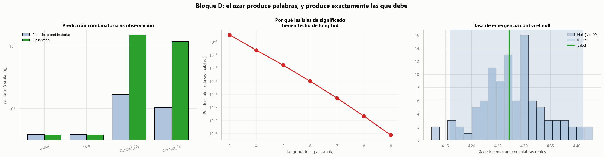

#### The strongest result in the study needs no null model at all

If Babel is i.i.d. noise over 26 letters, how many real words *must* emerge is not
something to measure. It can be **computed before looking at the text**:

<div align="center">

### `P(k) = N_k / 26^k`

</div>

| Condition | Predicted | Observed | **Obs / Pred** |
|:---|---:|---:|:---:|
| **Babel** | 3,860.9 | 3,766 | **0.98** |
| **Null** | 3,864.0 | 3,798 | **0.98** |
| Control EN | 16,725.3 | 150,914 | **9.02** |
| Control ES | 10,449.1 | 117,267 | **11.22** |

No fitted parameters. No null model. No NLP tool. Mean token length, predicted as a
geometric distribution with p = 3/29 at **8.67**, measured at **8.75**.

> **This changes the category of the conclusion.** Blocks A, B and C show that emergent
> structure is *indistinguishable* from chance. Block D shows that **it is chance, and
> here is the formula.**
>
> And that ratio becomes a direct measure of intent: real language produces **9 to 11
> times more** valid words than chance would explain.

#### Why the islands of meaning have a ceiling

| k | Words of length k | Possible strings 26ᵏ | P(k) |
|:---:|---:|---:|---:|
| 3 | 6,395 | 17,576 | **0.364** |
| 5 | 20,753 | 1.19 × 10⁷ | 0.00175 |
| 9 | 42,816 | 5.43 × 10¹² | **7.89 × 10⁻⁹** |

With three letters, **36% of all possible strings are real words**. With nine, eight in a
billion. The dictionary grows — but the space of strings grows by 26 at every step, and
that lost race is the entire explanation.

**Babel's longest real word is 5 letters. Spanish reaches 19.**

#### And one metric that did not work — reported anyway

The fourth part of this block searched the corpus for fragments semantically close to
Spanish probe phrases (*"love is eternal while it lasts"* and similar):

| Condition | Mean best-match similarity |
|:---|---:|
| Babel | 0.4252 |
| Null | 0.4314 |
| Control EN | 0.5108 |
| Control ES | 0.4621 |

Babel reaches 0.425 against Spanish's 0.462 — an 8% gap. **This does not mean Babel almost
contains those ideas. It means the metric does not do what it appeared to do.** BGE-M3
concentrates all text in a narrow cone — the same effect as the 0.888 similarity above — so
the floor for pure noise already sits at 0.42 and the useful range is tiny.

> **And there is a confounder, stated rather than buried:** English scores *higher* (0.5108)
> than Spanish (0.4621) against probes written *in Spanish*. Likely cause — CESS-ESP is
> financial press, thematically far from probes about love, time and death, while Moby Dick
> is narrative prose. The comparison between controls is not clean. It is reported in full
> because a negative is also a result, but it supports no conclusion on its own.

---

## 🧪 What the instrument was doing

Seven "findings" from intermediate runs turned out to be defects in the measuring
apparatus rather than properties of Babel. They are documented because they **are** the
lesson.

<details>
<summary><b>All seven artifacts, with mechanism and fix</b></summary>

<br>

| # | Artifact | Symptom | Real cause |
|:---:|:---|:---|:---|
| 1 | **Zipf** | 99th percentile | The fit included the hapax tail — nearly the whole vocabulary in random text, and a horizontal line in log-log |
| 2 | **χ²** | 100th percentile | The null was calibrated on a 9,475-character sample: it inherited that noise and added fresh noise on top |
| 3 | **Entropy** | 100th percentile | The null did not reproduce the page layout — newline frequency 1/81 instead of 1/79.06 |
| 4 | **Sentiment** | Babel at twice the null | Cleaning deleted commas and periods instead of treating them as word boundaries, gluing tokens together |
| 5 | **Token counts** | Two vocabularies, one corpus | Two modules tokenized differently — 111,797 vs 48,961 tokens from the same text |
| 6 | **Order-4 entropy** | **Inverted the conclusion** | See below |
| 7 | **n = 10** | 676 "peaks" | Sample size, not structure |

</details>

### The one that would have inverted a conclusion

Information gain behaves correctly up to order 3. At **order 4**:

| Condition | k=1 | k=2 | k=3 | **k=4** | obs/context |
|:---|---:|---:|---:|---:|---:|
| Babel | 0.0005 | 0.0155 | 0.5258 | **3.7446** | 2.0 |
| Null | 0.0005 | 0.0157 | 0.5254 | **3.7442** | 2.0 |
| Control EN | 0.9087 | 1.6198 | 2.2263 | 2.6823 | 17.9 |
| Control ES | 1.0852 | 1.6835 | 2.2663 | 2.7475 | 21.2 |

**At order 4 the plug-in estimator attributes 36% *more* sequential structure to random
noise than to Spanish.**

The cause is not the text — it is data scarcity. At order 4, random text generates over
half a million distinct contexts with **2.0 observations each**; every empirical
conditional distribution looks nearly deterministic, and conditional entropy collapses.
Natural language resists because it concentrates its mass in far fewer contexts.

> The null model gives 3.7442 against Babel's 3.7446 — four ten-thousandths apart. An
> absurd value that the statistical twin reproduces to that precision is not a finding;
> it is a property of the estimator.
>
> **Without the null model, this block would have published that noise has more memory
> than literature.** Not a subtle degradation — the opposite of the correct conclusion,
> with numbers to back it.

---

## 🖼️ Gallery

<table>
<tr>
<td width="50%" align="center">

**Rarest words in Babel** — the v1 wordcloud, rebuilt

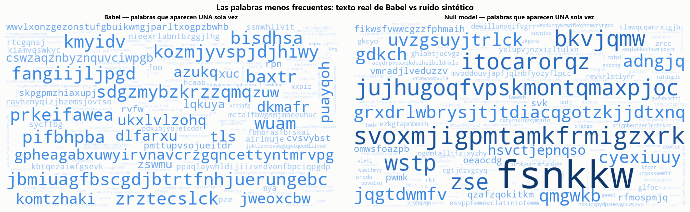

</td>
<td width="50%" align="center">

**Character bigram graph** — the most frequent transitions

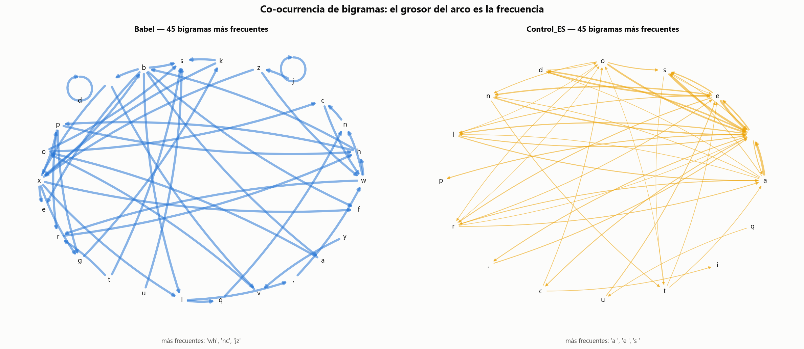

</td>
</tr>
<tr>
<td width="50%" align="center">

**Correlation landscape in 3D** — v1's six views, with a reference

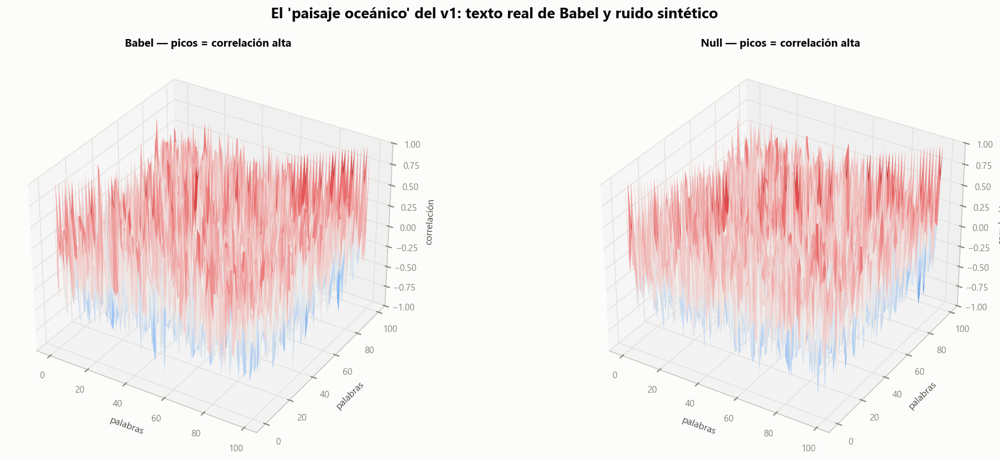

</td>
<td width="50%" align="center">

**Entropy and compression** — Babel against the ceiling

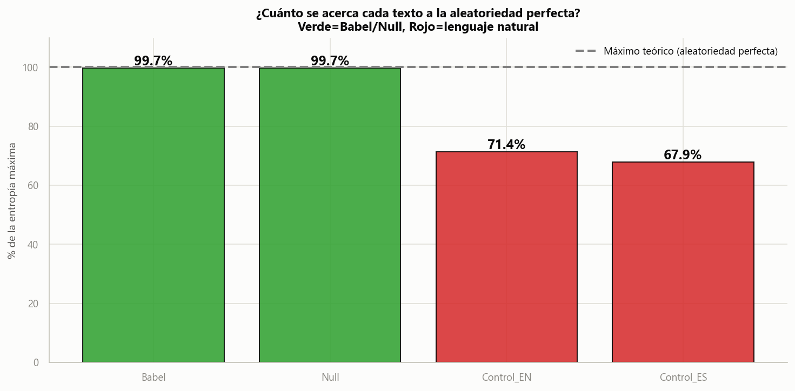
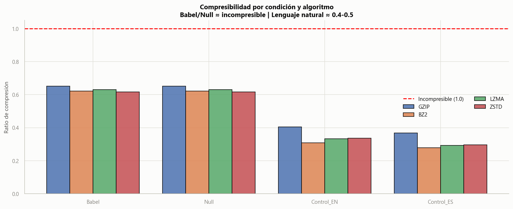

</td>
</tr>
</table>

<details>
<summary><b>The v1 figures, preserved</b></summary>

<br>

The original study's output is kept intact in [`Babel_V1/figures/`](Babel_V1/figures/) —
including `correlacion_palabras_top500_2.png`, a **40,691 × 44,966 pixel** correlation
map of 500 words. It is not linked inline because no browser will render it usefully,
which is itself part of the story.

| | |
|:---:|:---:|
| 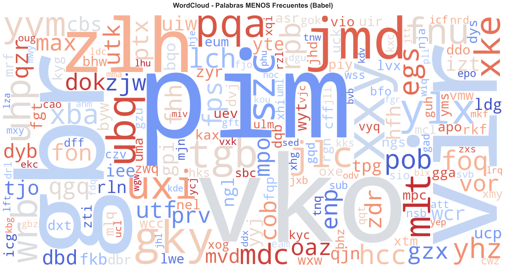 | 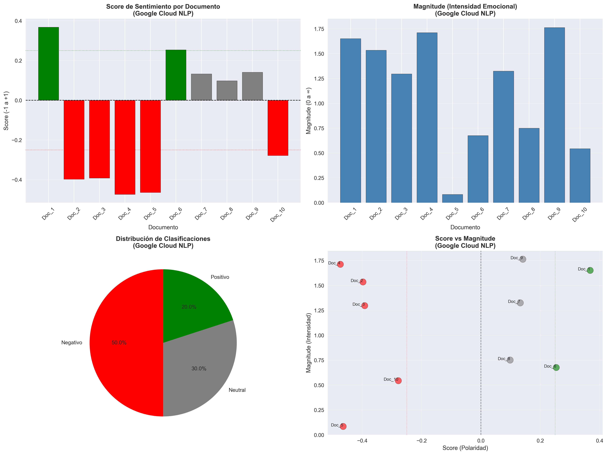 |
| Rare-word cloud | Sentiment analysis |
| 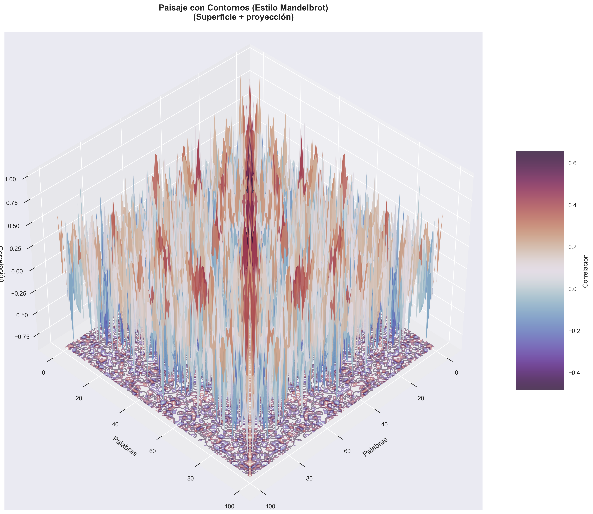 | 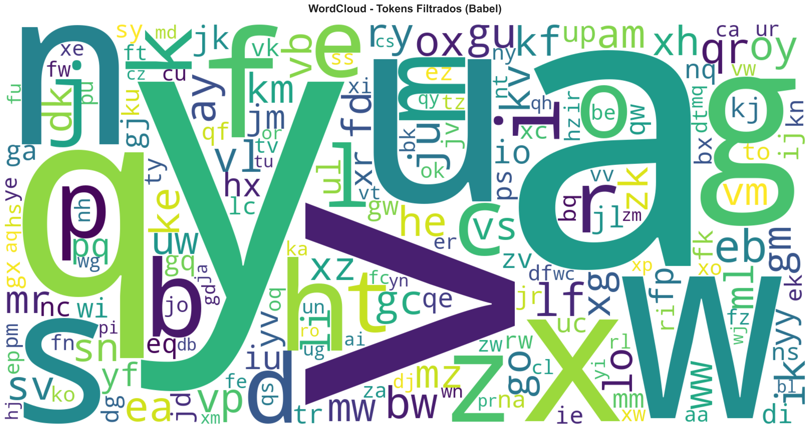 |
| 3D correlation contours | Filtered token cloud |

</details>

---

## 🛠️ Stack

<div align="center">

| Layer | Tools |
|:---|:---|
| **Core** | Python 3.12 · NumPy · pandas · SciPy · Matplotlib · Seaborn |
| **Classical NLP** | NLTK · spaCy · TextBlob · scikit-learn |
| **Information theory** | gzip · bz2 · lzma · zstandard |
| **Modern NLP** | PyTorch · transformers · sentence-transformers · fastText |
| **Unsupervised** | UMAP · HDBSCAN · BERTopic · datasketch |
| **Lexical** | wordfreq · pyspellchecker |
| **Models** | `BAAI/bge-m3` · `xlm-roberta-base-language-detection` · `twitter-xlm-roberta-base-sentiment` · `lid.176.bin` |

</div>

Every model is public, versioned and **runs on CPU**. The full study needs no GPU.

> **Why not frontier models everywhere?** Because the criterion depends on the direction
> of the argument. Where the claim is *"even the standard tool fails"*, the study uses the
> standard tool — `lid.176` is what actually filters CommonCrawl. Where the claim is
> *"not even the best finds anything"*, it uses the best available open model. Both
> choices are argued in [`STACK_Y_METODOLOGIA.md`](Documents/STACK_Y_METODOLOGIA.md).

---

## 📁 Repository structure

```
Mining the Random - Library of Babel/
│
├── 📕 Babel_V1/                            # PHASE 1 — the original study, preserved
│   ├── MINERIA_BIBLIOTECA_BABEL_v1.ipynb   # Notebook with its outputs embedded
│   ├── figures/                            # 6 original figures
│   └── README.md
│
├── 📗 Babel_V2/                            # PHASE 2 — the reconstruction
│   ├── MINERIA_BIBLIOTECA_BABEL_v2.ipynb   # Main notebook (dashboard, 76 cells)
│   ├── src/                                # Engine: pure, testable functions
│   │   ├── babel_core.py                   # Null model, controls, randomness metrics
│   │   ├── babel_pipeline.py               # Classic text mining pipeline
│   │   ├── babel_transformers.py           # Block B — transformers, fastText
│   │   ├── babel_secuencia.py              # Block C — Markov, entropy, perplexity
│   │   ├── babel_embeddings.py             # Block C — BGE-M3, UMAP, BERTopic, MinHash
│   │   ├── babel_lexico.py                 # Block D — external lexicon, combinatorics
│   │   └── babel_viz.py                    # Palette, style, v1 figures revisited
│   ├── tests/                              # 180 tests (pytest, ~15 s)
│   ├── outputs/                            # 27 result tables (CSV)
│   ├── figures/                            # 14 figures (PNG)
│   ├── requirements.txt · pytest.ini
│   └── README.md
│
├── 📄 Documents/
│   ├── CONTEXT.md                          # Scientific context, decisions, roadmap
│   └── STACK_Y_METODOLOGIA.md              # Stack, state of the art, methodology
│
├── 📦 data/                                # The 10 Babel books (13 MB, irreproducible)
└── README.md
```

**Strict separation of logic and presentation.** Everything in `src/` is pure, testable
and free of visualization. The notebook orchestrates, displays and narrates. v1 mixed both
in cells hundreds of lines long — which is exactly why it could not be maintained or tested.

---

## 🚀 Running it

```bash
pip install -r Babel_V2/requirements.txt
```

```bash
python -m spacy download es_core_news_sm && python -m spacy download en_core_web_sm
```

```bash
python -m textblob.download_corpora
```

```bash
python -c "import nltk; nltk.download('gutenberg'); nltk.download('cess_esp'); nltk.download('stopwords'); nltk.download('wordnet')"
```

Then open `Babel_V2/MINERIA_BIBLIOTECA_BABEL_v2.ipynb` in Jupyter and **Run All**.
The notebook locates the corpus automatically.

<div align="center">

| Block | Time (CPU, 12 cores) | Notes |
|:---|:---|:---|
| A — Foundations | ~3 min | No downloads |
| B — Modern NLP | ~12 min | ~3.2 GB of models on first run |
| C — Structure & geometry | ~42 min | ~4.3 GB more (BGE-M3) |
| D — Emergent meaning | ~4 min | Lexicons only |
| **Full run** | **~1 hour** | |

</div>

Each block has a flag (`EJECUTAR_BLOQUE_B`, `EJECUTAR_BLOQUE_C2`) to skip it, and
`MODO_RAPIDO_CHARS` runs a smoke test in about a minute.

**Tests:**

```bash
cd Babel_V2 && python -m pytest
```

180 tests in ~15 seconds. They **skip rather than fail** when the corpus or an optional
dependency is missing — so the suite runs on a machine with none of the 7.7 GB of models
downloaded.

> What makes them worth reading is *what* they test. Beyond the functions, they pin the
> study's **scientific invariants**: that Zipf does *not* separate Babel from Spanish, and
> that Heaps *does*, are both tests. If they start failing, the alarm sounds before the
> conclusions do.

---

## 🔍 Conclusion

> *Does true randomness leave traces? Can chaos generate patterns?*

**Not the ones we thought.** What the first version read as "islands of meaning" and
"shared statistical DNA" is precisely what the null model predicts — and in the case of
Block D, precisely what a closed-form equation predicts, to within 2%.

Babel's chaos does not converge on itself. It is noise, and it behaves like noise. The
structure we were seeing was our own linguistic instruments projected onto the void:
tools built to find language, finding "language" where there is none.

Which is, paradoxically, more Borgesian than the alternative. **The Library hides no
meaning in its chaos. The meaning is supplied by the librarian who reads.**

---

<div align="center">

### 📖 Further reading

**[`Documents/CONTEXT.md`](Documents/CONTEXT.md)** — scientific context, the 23 methodological
decisions and why none of them should be reverted

**[`Documents/STACK_Y_METODOLOGIA.md`](Documents/STACK_Y_METODOLOGIA.md)** — reasoned inventory
of the stack, state of the art of each tool, and the full methodology

<br>

---

**Diego Evans Pérez Paz**
*Complejidad y Caos* — January 2026

</div>
